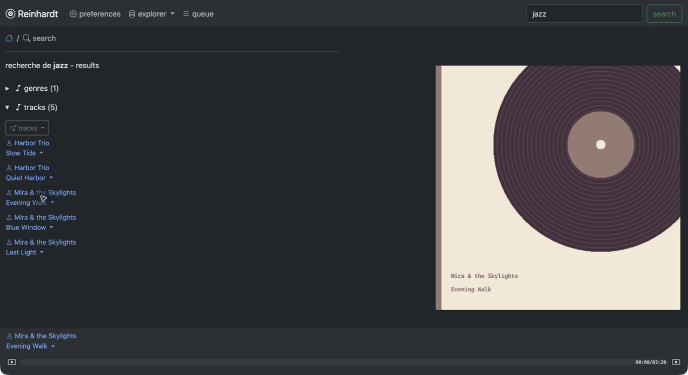
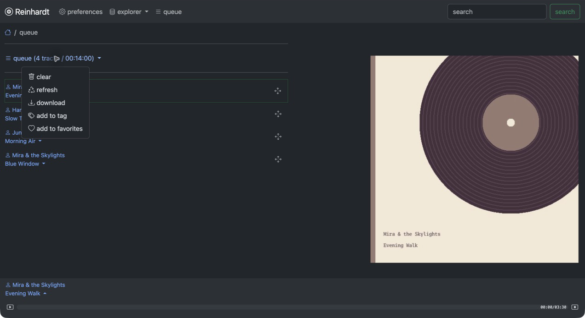
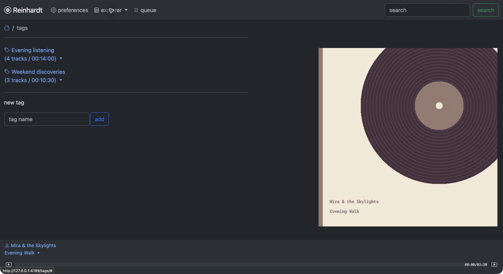
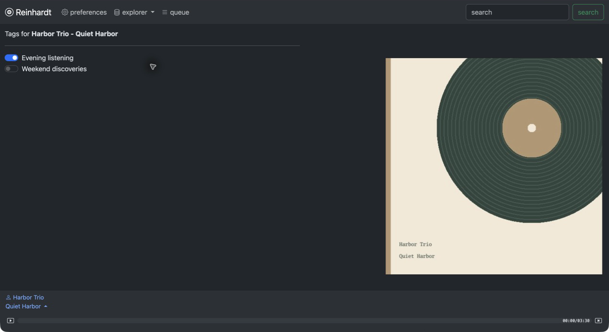
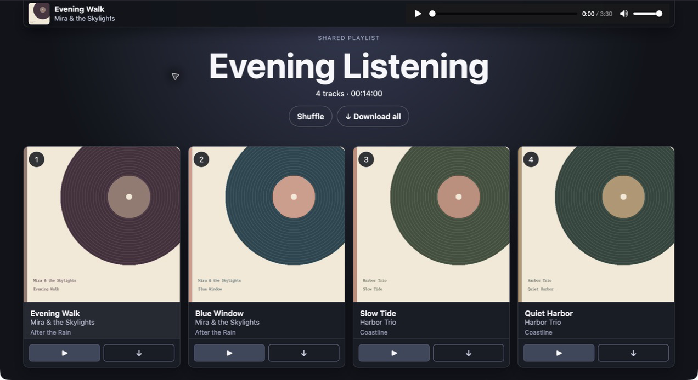
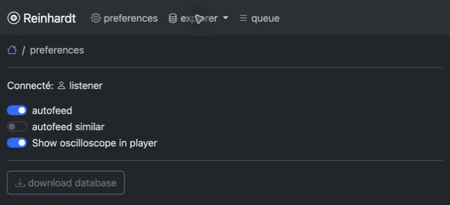
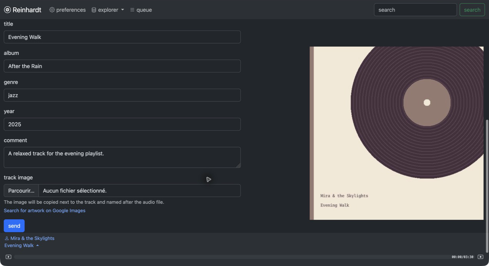
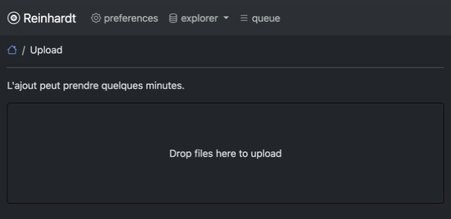
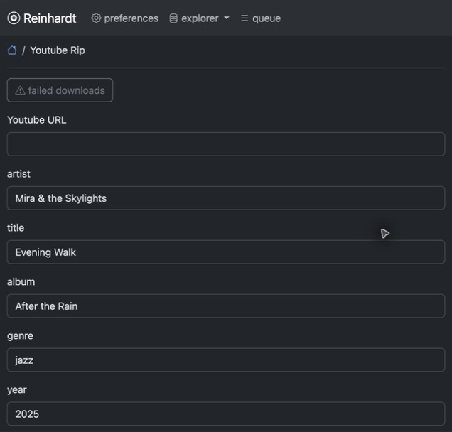
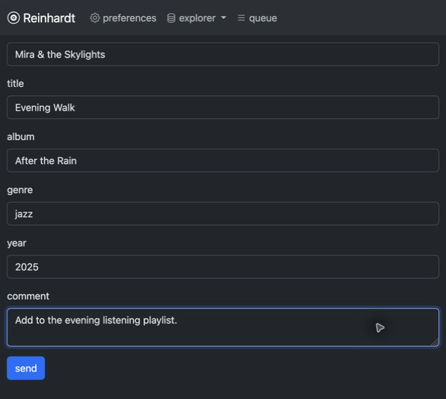

# Reinhardt user manual

Reinhardt lets you browse your music collection, listen in a web browser, build
playlists, and share them. It runs on the computer that stores your music; you
use its interface in a browser on that computer or another connected device.

This guide uses the ready-to-run downloads from GitHub. You do not need Go,
Git, Make, or a source checkout. Local music playback requires no additional
programs. YouTube downloads need the [optional media tools](#optional-media-tools).

Jump to [Download](#download-the-application), [Install](#install),
[First-run setup](#set-up-your-library-and-account),
[Using the library](#use-the-music-library), [Adding music](#add-more-music),
[Media tools](#optional-media-tools), [Other devices](#listen-from-another-device),
[Accounts](#accounts-and-email-login), [Settings](#settings-and-saved-data),
[Backups and updates](#back-up-update-and-restore), or
[Troubleshooting](#troubleshooting).

## Download the application

Open the [latest release](https://github.com/johndoe46/reinhardt-go-port/releases/latest)
and expand **Assets**. Select the archive for the computer that will run
Reinhardt, rather than the device you will listen on.

| Your computer | Archive filename ending |
| --- | --- |
| Linux, Intel or AMD 64-bit | `linux-amd64.tar.gz` |
| Linux, ARM 64-bit, including Raspberry Pi with a 64-bit OS | `linux-arm64.tar.gz` |
| macOS, Intel | `darwin-amd64.tar.gz` |
| macOS, Apple Silicon (M-series) | `darwin-arm64.tar.gz` |
| Windows, Intel or AMD 64-bit | `windows-amd64.zip` |

For example, a Linux download is named
`reinhardt-vVERSION-linux-amd64.tar.gz`, where `VERSION` is the release number.
The **Source code** downloads do not contain the ready-to-run application.
If there are no release archives yet, check the
[Releases page](https://github.com/johndoe46/reinhardt-go-port/releases) for a
published version.

On Linux, `uname -m` usually reports `x86_64` for `amd64` or `aarch64` for
`arm64`. On macOS, **Apple menu > About This Mac** shows your chip or processor.
On Windows, check **Settings > System > About > System type**. These downloads
do not include a 32-bit edition or a native Windows ARM edition.

### Optional: check the download

Download `SHA256SUMS` from the same release. Calculate the archive's SHA-256
checksum and compare it with the line for that exact filename in `SHA256SUMS`.
Replace the example filename below with your downloaded archive's name.

Linux:

```sh
sha256sum reinhardt-vVERSION-linux-amd64.tar.gz
```

macOS:

```sh
shasum -a 256 reinhardt-vVERSION-darwin-arm64.tar.gz
```

Windows PowerShell:

```powershell
Get-FileHash .\reinhardt-vVERSION-windows-amd64.zip -Algorithm SHA256
```

The hexadecimal values must match; letter case does not matter. If they differ,
download the archive again before using it.

## Install

### Linux and macOS

Create a folder named `Reinhardt` in your home folder and extract the archive
there. You can use your archive manager, or run the following in Terminal.
Replace the archive filename with the one you downloaded:

```sh
mkdir -p "$HOME/Reinhardt"
tar -xzf "$HOME/Downloads/reinhardt-vVERSION-linux-amd64.tar.gz" -C "$HOME/Reinhardt"
cd "$HOME/Reinhardt"
chmod +x reinhardt
./reinhardt --help
```

On macOS, use your `darwin` archive in the extraction command. If macOS blocks
the first launch, follow
[Apple's instructions for opening downloaded applications](https://support.apple.com/en-us/102445).
For a download you trust, this may involve **System Settings > Privacy & Security >
Open Anyway**, then trying the command again.

Keep the extracted files in this folder. No administrator privileges are needed
to install or run Reinhardt in your home folder.

### Windows

Right-click the downloaded ZIP and choose **Extract All**. Use a folder such as
`C:\Users\YourName\Reinhardt`. Make sure `reinhardt.exe` is directly inside that
folder. Open PowerShell and enter:

```powershell
Set-Location "$HOME\Reinhardt"
.\reinhardt.exe --help
```

Run the application from PowerShell with a command such as `serve`; double-clicking
the executable does not start the web interface.

## Set up your library and account

Run the commands below from your installation folder. Replace the example music
path with the folder containing your music. Use quotation marks around paths,
especially when they contain spaces.

### 1. Create your settings file

Create a plain text file named `.env` in the same folder as the executable,
containing:

```dotenv
LISTEN_ADDR=127.0.0.1:8000
ALLOWED_HOSTS=127.0.0.1,localhost
ACCESS_URL_PREFIX=http://127.0.0.1:8000
```

On Windows, use Notepad's **Save as type: All files** so the filename is `.env`,
not `.env.txt`. On macOS, use a plain text editor rather than rich text.
This configuration makes Reinhardt available on this computer and prints
complete login links. Restart the application after changing settings.

### 2. Register your music folder and scan it

Linux and macOS:

```sh
./reinhardt addmusicdir "/absolute/path/to/Music"
./reinhardt indexmusic
```

Windows PowerShell:

```powershell
.\reinhardt.exe addmusicdir "C:\Users\YourName\Music"
.\reinhardt.exe indexmusic
```

The scan includes subfolders and indexes MP3 and M4A files. It reads their
metadata and leaves the files in their existing locations. Large collections
may take a while to scan. To register another folder, run `addmusicdir` again
with its path, then run `indexmusic`.

Your account needs permission to read the music folders. Editing track details
or importing music also requires write permission to the affected folders.

### 3. Create your account

Linux and macOS:

```sh
./reinhardt giveaccess owner --superuser
```

Windows PowerShell:

```powershell
.\reinhardt.exe giveaccess owner --superuser
```

You can replace `owner` with your preferred username. The command prints your
login link. Save it privately: anyone with that link can sign in as you.
`--superuser` gives this account permission to edit track details, upload music,
and download database backups.

### 4. Start Reinhardt and sign in

Linux and macOS:

```sh
./reinhardt serve
```

Windows PowerShell:

```powershell
.\reinhardt.exe serve
```

Leave this terminal open. Open the login link from the previous step in your
browser. After signing in, you can return to
[http://127.0.0.1:8000](http://127.0.0.1:8000).

The application must stay running for browsing, playback, and background imports
to work. Keep the host computer awake. Press **Ctrl+C** in the terminal to stop
it; start it again with `serve`. Your library, accounts, and playlists are saved.

## Use the music library

The screenshots below show a sample library. Your music and browser theme may
differ.

### Browse, search, and play

Use the search box to find music, or open **Explorer** to browse **Artists**,
**Genres**, **Favorites**, and **Tags**. The home page shows recent additions.


*The Explorer menu provides access to favorites, artists, genres, and tags.*



*Search results appear above the player, which remains available while browsing.*

Open a track's menu and choose **Play now** to start it, or **Add to queue** to
save it for later. The player stays at the bottom of the page as you browse.
Use its playback controls to pause, seek within a track, or move to the next one.
You may need to press Play once if your browser prevents automatic playback.


*Open a track's menu to play it, queue it, download it, or add it to favorites.*

Open **Queue** to see upcoming tracks. Drag the handles to change their order,
or use a track's menu to remove it. The queue menu can shuffle or clear the queue, download
its tracks, or add them to a tag or your favorites. Removing a track from a queue
or tag does not delete the audio file.



*Use the handles to reorder tracks and the queue menu for actions on the list.*

### Favorites and playlists

Choose **Add to favorites** from a track's menu to bookmark it. Find these tracks
under **Explorer > Favorites**.

Tags act as named playlists. Under **Explorer > Tags**, enter a name in **New
tag** and choose **Add**. Use a track's **Manage tags** menu to switch its
membership on or off. A track can belong to several tags. Open a tag to play its
tracks, change their order with the handles, or add them all to the queue.
The tag menu also offers rename, download, and remove actions. Playlist downloads
are ZIP archives of the audio files, rather than a single mixed recording.



*Create named playlists on the Tags page.*



*Switch a tag on or off to add or remove this track from that playlist.*

### Share a playlist

In **Explorer > Tags**, open the tag's menu and choose **Generate share link**,
then **Open share link**. Copy that page's address to send it to someone else.
Anyone with the shared link can listen without an account; it grants access to
the tracks in that playlist. A download-all option is available when the
playlist is below the configured duration limit (three hours by default).

Choose **Remove shared link** in the tag's menu to disable access. For someone
on another device to use the link, your server must be reachable from that
device; see [Listen from another device](#listen-from-another-device).


*Once sharing is enabled, the tag menu lets you open or disable the shared link.*



*Recipients can play individual tracks, shuffle the playlist, and download music.*

### Playback preferences

Open **Preferences** and choose a **Language** to switch between English and
French for your account. The choice saves automatically. **Server default** follows the
administrator's language setting. Saving a language keeps playback running and
updates the settings text immediately. Refresh the whole page when you want the
change to take full effect. The choice persists when you log in again.

Open **Preferences** to change these options; switches save automatically:

- **Autofeed** automatically supplies more tracks when the queue runs out.
- **Autofeed similar** prefers similar artists when autofeed is enabled.
- **Show oscilloscope in player** toggles the animated sound display.



*Language selection and playback switches save automatically.*

### Edit track details and artwork

With an administrator account, choose **Details** in a track's menu to edit its
artist, title, album, genre, year, and comment, or upload a cover image.
Artist and title are required. MP3 metadata changes are also written to the
audio file. Uploaded artwork is saved beside the track and embedded where
supported; embedding in M4A and other non-MP3 formats needs FFmpeg.



*The Details editor includes metadata fields and a cover-image upload. Scroll
down past the artwork preview to reach these controls.*

## Add more music

For files copied directly into a registered music folder, run `indexmusic` again
from a second terminal in your installation folder. The command also marks
missing files as unavailable after you move or remove them. It does not delete
music files. Use the same settings file for this command and the running server.

### Uploads and an import folder

File uploads require an administrator (**superuser**) account, granted with
`giveaccess <username> --superuser`. The upload page has no navigation-menu
entry: open `/upload/` directly at your server's address, for example
`http://127.0.0.1:8000/upload/`.

Create a separate folder for incoming music, then add its absolute path to
`.env`. Use forward slashes in Windows settings files, for example:

```dotenv
# Linux example; replace with your actual folder:
MUSIC_IMPORT_DIR=/home/yourname/Music-Incoming
# Windows alternative:
# MUSIC_IMPORT_DIR=C:/Users/YourName/Music-Incoming
```

Restart Reinhardt, sign in with your superuser account, and open the upload
address. Drag MP3, M4A, or ZIP files into the upload area, or click it to choose
files. You can also copy files into the incoming folder yourself.



*Open `/upload/` directly, then drop files here or click to choose them.*

The application checks that folder every five minutes and imports music into
the first registered music directory. Keep the incoming folder separate from
your library. Imports do not overwrite existing music files. To process incoming
files immediately, run `./reinhardt gathermusic` (or
`.\reinhardt.exe gathermusic` on Windows).

### YouTube downloads

The download form is available to signed-in users. It has no navigation-menu
entry: open `/ytrip/` directly at your server's address, for example
`http://127.0.0.1:8000/ytrip/`.

Install the media tools below and ensure at least one music folder is registered.
Enter the YouTube URL, artist, and title. Album, genre, year, and comment are
optional. Scroll down to the **Send** button to submit the form. The download
runs in the background and is imported into the first registered music
directory. Keep Reinhardt running while it processes the download.



*Open `/ytrip/` directly and enter the video URL and track information.*



*Scroll down to add a comment and choose Send to queue the download.*

Reviewing and retrying failed downloads requires a **superuser** account. Use
the **Failed downloads** button or open `/ytrip/failures/` directly to review
failures and retry them after fixing the cause. Other users can ask an
administrator to do this. Terminal messages can help identify missing tools or
network errors.

## Optional media tools

Install these only for the features you need:

| Tool | Needed for |
| --- | --- |
| `yt-dlp` | YouTube metadata, audio, and thumbnail downloads |
| `ffmpeg` and `ffprobe` | YouTube audio conversion and inspection; FFmpeg also embeds non-MP3 artwork |
| Deno 2.3 or newer | YouTube's JavaScript challenges |

The yt-dlp EJS component is also required. Its official standalone executables
include it; Python installations should use the `default` dependency group.
See the [yt-dlp installation guide](https://github.com/yt-dlp/yt-dlp/wiki/Installation)
and [YouTube JavaScript setup guide](https://github.com/yt-dlp/yt-dlp/wiki/EJS).

On macOS, with [Homebrew](https://brew.sh/) installed:

```sh
brew install yt-dlp ffmpeg deno
```

On Debian or Ubuntu:

```sh
sudo apt update
sudo apt install -y ffmpeg python3 pipx curl ca-certificates unzip
pipx install 'yt-dlp[default]'
pipx ensurepath
curl -fsSL https://deno.land/install.sh | DENO_INSTALL="$HOME/.local" sh
export PATH="$HOME/.local/bin:$PATH"
```

Run the pipx and Deno installs as the account that runs Reinhardt. Python is used
by that yt-dlp installation, not by Reinhardt itself. Add the `PATH` setting to
your shell profile if needed for later sessions. See
[Deno's installation instructions](https://docs.deno.com/runtime/getting_started/installation/).

On Windows, download the official `yt-dlp.exe` from
[yt-dlp releases](https://github.com/yt-dlp/yt-dlp/releases/latest), a Windows
build containing `ffmpeg.exe` and `ffprobe.exe` from the links on
[FFmpeg's download page](https://www.ffmpeg.org/download.html), and Deno using
[its installation instructions](https://docs.deno.com/runtime/getting_started/installation/).
Add the folders containing those executables to your user `PATH`, then open a
new PowerShell window.

From the terminal you use to start Reinhardt, check:

```text
yt-dlp --version
ffmpeg -version
ffprobe -version
deno --version
```

Restart Reinhardt after installing or updating these tools. For updates, use
`brew upgrade yt-dlp ffmpeg deno` on macOS; on Debian/Ubuntu, use
`pipx upgrade yt-dlp`, `deno upgrade`, and your usual system package updates.
For Windows standalone yt-dlp, use `yt-dlp -U`; update FFmpeg and Deno through
their installation method.

## Listen from another device

To use Reinhardt on a phone or another computer on your home network, find the
host computer's local IP address, for example `192.168.1.50`. Change `.env` to:

```dotenv
LISTEN_ADDR=0.0.0.0:8000
ALLOWED_HOSTS=127.0.0.1,localhost,192.168.1.50
ACCESS_URL_PREFIX=http://192.168.1.50:8000
```

Replace the example IP with your host's address, restart Reinhardt, and allow
incoming connections to port 8000 on your private network if the host's firewall
requires it. On the other device, open `http://192.168.1.50:8000` or a login link
printed with these settings. `127.0.0.1` always refers to the device you are
currently using, so it cannot reach Reinhardt on another computer.

For access over the internet, use an HTTPS reverse proxy or a private VPN.
For an HTTPS address such as `https://music.example.com`, set
`ALLOWED_HOSTS=music.example.com`, `ACCESS_URL_PREFIX=https://music.example.com`,
`CSRF_TRUSTED_ORIGINS=https://music.example.com`, and `COOKIE_SECURE=true`.
The reverse proxy should forward requests to Reinhardt's local listening
address. Keep `COOKIE_SECURE=false` when using plain HTTP locally.

## Accounts and email login

Each account has its own queue, favorites, tags, and preferences. To give another
person access, run:

```sh
./reinhardt giveaccess alice --email alice@example.com
```

On Windows, use `.\reinhardt.exe` instead of `./reinhardt`. Send that person the
printed login link privately. Add `--superuser` only for accounts that should
have administrative access. To recover existing login links, run
`./reinhardt listaccess` (or `.\reinhardt.exe listaccess`).

Email login is optional. To let existing accounts request a link on the login
page, set their email address using `giveaccess` and configure your mail
provider's SMTP settings in `.env`. A typical STARTTLS configuration is:

```dotenv
EMAIL_HOST=smtp.example.com
EMAIL_PORT=587
EMAIL_USE_TLS=true
EMAIL_USE_SSL=false
EMAIL_HOST_USER=your-smtp-username
EMAIL_HOST_PASSWORD=your-smtp-password
DEFAULT_FROM_EMAIL=music@example.com
```

Use the settings supplied by your provider. For implicit TLS, providers commonly
use port 465 with `EMAIL_USE_SSL=true` and `EMAIL_USE_TLS=false`. Restart after
changing these settings. The login page sends links only for existing accounts;
it does not create accounts. Direct login links work without email setup.

## Settings and saved data

Always start Reinhardt from the installation folder so it reads that folder's
`.env`. Alternatively, specify the file explicitly, for example:

```sh
./reinhardt --env-file "/absolute/path/to/reinhardt.env" serve
```

Use that same `--env-file` option for library and account commands. Settings in
the process environment override the settings file. You can inspect the active
settings with `./reinhardt config` or `.\reinhardt.exe config`; passwords and
keys are hidden in the output.

Numeric and boolean settings are parsed and validated at startup. Invalid values stop the application
with an error naming the setting, before it opens the database. Boolean settings
accept `true`/`false`, `yes`/`no`, `on`/`off`, and `1`/`0`, without case sensitivity;
an empty boolean value disables the setting. `MAX_UPLOAD_BYTES` must be a positive
integer, `SHARED_PLAYLIST_DOWNLOAD_MAX_SECONDS` and `LOG_LEVEL` must be
non-negative integers, and `EMAIL_PORT` must be between 1 and 65535. An optional
`JAMA_PROJECT` must be a positive integer when set. The `config` command displays
the parsed values, including normalized booleans and comma-separated lists.

Similar-artist suggestions use Last.fm with the existing bundled API key by
default. To use your own key, add `LASTFM_API_KEY=your-lastfm-api-key` to `.env`
or set it in the process environment. Leave the setting unset to keep the
bundled default. Restart Reinhardt after changing this setting.

By default, saved data lives in `.reinhardt` inside the home folder of the
account running the application:

- Linux/macOS: `~/.reinhardt`
- Windows: typically `C:\Users\YourName\.reinhardt`

This includes the library database (`db.sqlite3`), accounts, playlists, saved
preferences, and cached covers. Music stays in the registered music directories.
Your installation folder's `.env` is separate from this saved data.

To choose another data folder, add `BASE_DIR=/absolute/path/to/data` to `.env`
(use a path such as `C:/ReinhardtData` on Windows). Changing it selects another
database; it does not move your existing data.

## Back up, update, and restore

### Backups

As an administrator, open **Preferences > Download database** to save a
consistent database backup while the application runs. It contains accounts and
login information, so keep it private. It does not include your music files,
cover files, or `.env` settings.

For a complete backup, stop Reinhardt and copy its data folder, your `.env`, and
your music directories to another drive or backup location. If you configured
separate database or cover paths, include those too. Stop every Reinhardt process
before copying a database directly; use the browser's download option for a
database backup while it is running.

### Updates

1. Back up your data and read the new release's notes.
2. Stop Reinhardt with **Ctrl+C** (or stop its service if you run it as one).
3. Download the new archive for the same platform and extract it separately.
4. Replace your installed `reinhardt` or `reinhardt.exe` with the new executable.
   You can also replace this manual, the README, and the bundled
   `docs/images/user-manual` folder. Keep your `.env` and data.
5. On Linux/macOS, run `chmod +x reinhardt` if necessary, then start with `serve`.

Your accounts, library, and playlists remain in the data folder. To revert to
an older release after a database change, restore the backup made before the
update as well as the older executable.

### Restore

Stop Reinhardt, keep a copy of the current data, and restore your backed-up data
folder and `.env`. To restore a downloaded database backup, put it at the
configured database path (normally `.reinhardt/db.sqlite3`). Move any existing
`db.sqlite3-wal` and `db.sqlite3-shm` files aside together with the old database
before replacing it. Restore music to the paths registered in the database,
then start Reinhardt again.

## Troubleshooting

| Problem | What to check |
| --- | --- |
| The executable will not start | Match the archive to your OS and processor; on Linux/macOS check `chmod +x reinhardt`. |
| The browser cannot connect | Keep `serve` running and use the address printed in the terminal. For another device, check the host IP, listening address, and firewall. |
| Port 8000 is already in use | Stop the other instance, or choose another port, such as 8001, in both `LISTEN_ADDR` and `ACCESS_URL_PREFIX`. |
| The server rejects the hostname | Add the hostname or IP you use to `ALLOWED_HOSTS`, without a scheme or port, then restart. |
| The library is empty or tracks are missing | Register the correct folder and run `indexmusic` with the same `.env` and data folder as the server. Check file permissions and reconnect external drives. |
| Playback is silent or will not start | Press Play, check browser/tab and system volume, and confirm the audio file still exists and is playable by your browser. |
| You cannot edit details or upload | Sign in with an account granted `--superuser`; uploads also need `MUSIC_IMPORT_DIR`. |
| Imports or YouTube downloads are stuck | Keep the server running, check the first registered music folder is writable, and review terminal messages. For YouTube, check all four media tools and update yt-dlp. |
| Email links do not arrive | Check the account's email, SMTP settings, and spam folder. Recover a direct login link with `listaccess`. |
| Login does not stay signed in over local HTTP | Keep `COOKIE_SECURE=false`; use `true` for HTTPS access. |

For a database health check, run `./reinhardt check` or
`.\reinhardt.exe check` with your usual settings. Use `--help` on any command for
its available options. To report a problem, include the release version, OS,
and relevant terminal messages in a
[GitHub issue](https://github.com/johndoe46/reinhardt-go-port/issues), omitting
passwords, login links, and other private information.
